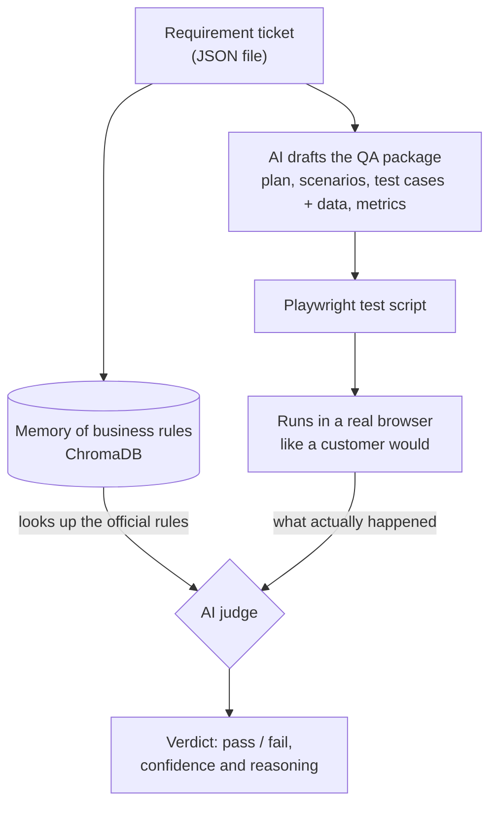

# Dynamic QA Agent

**Hand it one requirement ticket. Get back a complete QA package: test plan, test scenarios, test cases with test data, quality metrics and a ready-to-run browser test script. Then let an AI judge check the real website against the same business rules.**


---

## Table of Contents

1. [What Is This?](#what-is-this)
2. [What Goes In, What Comes Out](#what-goes-in-what-comes-out)
3. [A Real Example](#a-real-example)
4. [How It Works](#how-it-works)
5. [Why Each Step Exists](#why-each-step-exists)
6. [Why RAG?](#why-rag)
7. [Why ChromaDB?](#why-chromadb)
8. [Technology Choices at a Glance](#technology-choices-at-a-glance)
9. [How It Was Built](#how-it-was-built)
10. [Key Ideas in Plain English](#key-ideas-in-plain-english)
11. [Benefits for Teams](#benefits-for-teams)
12. [Workflows Covered](#workflows-covered)
13. [What Is Inside](#what-is-inside)
14. [For Developers](#for-developers)
15. [Resiliency and Offline Mode](#resiliency-and-offline-mode)
16. [Author](#author)

---

## What Is This?

When a team builds a new feature, a QA engineer normally has to:

1. Read the requirement and work out what must be tested.
2. Write a test plan and a list of test scenarios.
3. Write detailed test cases and prepare test data.
4. Script the tests so they can run automatically.
5. Run them and decide whether the feature really follows the business rules.

That is a lot of manual effort, repeated for every feature.

**The Dynamic QA Agent produces the first draft of all of this from a single requirement file**, then runs the tests in a real browser and checks the outcome against the original rules. A QA professional reviews and refines the output instead of starting from a blank page.

Think of it as a tireless junior tester who never skips a step, always reads the requirement first, and shows its reasoning.

> **Two design choices make this trustworthy**
>
> - **RAG: the AI reads your rules instead of guessing them.** Before it writes or judges anything, the agent looks up the relevant acceptance criteria. See [Why RAG?](#why-rag)
> - **ChromaDB: the rules live in a local, free, searchable memory.** No server, no subscription, and it works without internet. See [Why ChromaDB?](#why-chromadb)

## What Goes In, What Comes Out

| You provide | The agent produces |
|---|---|
| **One requirement ticket** (a JSON file with the feature summary and its acceptance criteria) | **Test plan**: scope and approach |
| | **Test scenarios**: the situations to cover |
| | **Test cases with test data**: step-by-step checks and the inputs to use |
| | **Test metrics**: a summary of the generated test set |
| | **Playwright script**: an automated browser test, ready to run |
| | **Verdict**: pass or fail, with a confidence level and written reasoning |

## A Real Example

This is an abridged requirement ticket for the shopping cart (`requirements/ticket_cart.json`):

```json
{
  "project": "Product Catalog & Cart",
  "summary": "Implement product variant selection and Add to Cart functionality",
  "description": "Shoppers must be able to select product options (Size, Color) and add them to their cart...",
  "acceptance_criteria": [
    "**Variant Updates:** Selecting a product variant must dynamically update the displayed stock status...",
    "**Instant Counter Badge:** Clicking 'Add to Cart' must instantly update the header cart counter...",
    "**Stock Limitation Alerts:** Attempting to add a quantity exceeding available stock must display...",
    "**Session Persistence:** Cart items must persist securely in local storage or user session...",
    "**Account Safety:** The items in the cart must belong only to the person currently logged in...",
    "**Quantity Rules:** The quantity box must block negative numbers, zero (where not allowed), letters...",
    "**Price Protection:** If someone tries to trick the system by changing the price on their screen...",
    "**Anti-Spam:** Clicking 'Add to Cart' rapidly or using automated scripts should be blocked...",
    "**Display Check:** The shopping cart updates subtotals, taxes, and shipping estimates correctly..."
  ]
}
```

From that one file, the agent generates the files below. You can open them to see the real output:

| Generated item | Location |
|---|---|
| Test plan | [`deliverables/cart/test_plan.md`](deliverables/cart/test_plan.md) |
| Test scenarios | [`deliverables/cart/test_scenarios.md`](deliverables/cart/test_scenarios.md) |
| Test cases and test data | [`deliverables/cart/test_cases.md`](deliverables/cart/test_cases.md) |
| Test metrics | [`deliverables/cart/test_metrics.md`](deliverables/cart/test_metrics.md) |
| Automated browser test | [`automated-scripts/cart/cart.spec.ts`](automated-scripts/cart/cart.spec.ts) |

The same structure exists for the registration and checkout workflows.

## How It Works



**In five steps:**

1. **Read** the requirement ticket.
2. **Remember** the business rules in a searchable memory, so the agent always works from the official source.
3. **Draft** the test plan, scenarios, test cases, test data and metrics, and turn them into a Playwright script.
4. **Run** the script in a real browser, clicking through the site like a customer.
5. **Judge** the result: an AI compares what happened with what the requirement says and explains its verdict.

## Why Each Step Exists

Every step in the pipeline solves a specific problem that appears when AI is used for testing. This is the reasoning behind the design.

| Step | The problem it solves | What goes wrong without it |
|---|---|---|
| **1. Start from a structured requirement ticket** | Test ideas often come from memory, chat threads or scattered documents, so tests drift away from what was actually agreed. A ticket with clear acceptance criteria gives the agent one agreed source to work from. | Tests check what someone assumed, not what the business asked for. |
| **2. Store the rules in a searchable memory ([RAG](#why-rag) with [ChromaDB](#why-chromadb))** | AI models do not know your company's rules, and when unsure they tend to give confident but invented answers. Pasting every requirement into every prompt is slow, costly and buries the relevant rule in noise. RAG looks up only the rules that matter for the task at hand. The memory is stored locally, so lookups are free and fast, and the rules can be refreshed whenever a ticket changes. | The AI guesses, or you re-send everything each time and still risk missing the key rule. |
| **3. Check that the right rule is retrieved** | Everything downstream trusts what the memory returns. If it returns the wrong rule, the judge grades against the wrong standard and still sounds confident. A separate check tests retrieval on its own. | Mistakes hide inside the final verdict, where they are hard to spot. |
| **4. Generate the test plan, scenarios, test cases with data, and metrics** | Each document does a different job. The **plan** sets scope and approach for stakeholders. The **scenarios** list the situations to cover. The **test cases with data** give testers exact steps and inputs. The **metrics** show how much is covered. Writing all four by hand is repetitive and the structure varies between people. | Documents are skipped, inconsistent, or leave coverage gaps. |
| **5. Turn the cases into a Playwright script and run it in a real browser** | Documents alone prove nothing. A script lets the same checks run on every release without manual effort, and a real browser produces real evidence of what the site actually did. | Tests stay on paper, and verdicts would rest on assumptions. |
| **6. Judge the result with an AI against the retrieved rules** | Ordinary scripts verify technical actions, such as a button clicking or a page loading. Many business rules are about meaning, for example "cart items must belong only to the person logged in". An AI judge can compare the evidence with the rule written in words, then explain its decision with reasoning and a confidence level, so people can audit it. | You only get technical pass/fail, and business-rule checks fall back to manual review. |
| **7. Use a 45-second timeout and an offline mode** | AI services can be slow, rate-limited or unreachable. A pipeline that waits forever or crashes is worse than having none. | Test runs hang or fail for reasons unrelated to the software being tested. |
| **8. Self-healing for broken scripts** | Web pages change, and small changes can break automated scripts. Fixing them takes QA time without finding any bugs. The self-healing agent diagnoses the failure and proposes a repair. | QA time goes into maintaining scripts instead of finding defects. |
| **9. Keep a human in the loop** | AI makes mistakes. Its output is a strong first draft, and a QA professional reviews and signs off. | Errors pass unchecked into release decisions. |

**Design principles in one line each**

- **Look up before you write.** The agent consults the official rules first.
- **Verify before you trust.** Retrieval is tested separately from judging.
- **Fail safe, never hang.** Timeouts and offline mode keep runs moving.
- **Humans decide.** AI drafts and explains; people approve.

## Why RAG?

**RAG (Retrieval-Augmented Generation)** means the AI first *retrieves* the relevant rules from a trusted source, then *generates* its answer using them. It is an open-book exam instead of a closed-book one.

### The problem

An AI model has never seen your company's requirements. Asked to test a shopping cart, it will happily produce plausible-sounding tests based on what carts usually do, not on what *your* ticket says. For example, it will not know that your cart must block rapid repeated clicks, or that the cart must belong only to the logged-in person. In QA, a confident answer built on a wrong assumption is the most dangerous kind, because it looks right.

### Why not simpler alternatives?

| Approach | How it works | Why it falls short here |
|---|---|---|
| Rely on the AI's own knowledge | Ask the AI to test "a shopping cart" | It has never seen your rules, so it fills gaps with guesses |
| Paste every requirement into every prompt | Send all tickets each time | Costs more, runs slower, buries the key rule in noise, and stops working as the number of tickets grows |
| Keyword search | Find documents containing the same words | Misses rules that mean the same thing in different words |
| Fine-tune a model on your rules | Retrain the AI on your documents | Slow and expensive, must be repeated whenever a rule changes, and cannot point to its source |
| **RAG (chosen)** | Look up the most relevant rules by meaning, then give only those to the AI | Grounded in your real rules, instantly up to date, and traceable to the ticket |

### What RAG gives this project

- **Fewer made-up requirements.** The agent works from the written criteria, not from assumptions.
- **One source of truth.** Change a rule in the ticket, re-index it, and every later test and verdict uses the new rule. No test code needs rewriting.
- **Traceability.** Each verdict can be traced back to the exact criteria that were retrieved.
- **Lower cost per run.** Only the relevant rules go to the AI, not the whole library.
- **Measurable quality.** Retrieval can be tested on its own (`verify_requirement_retrieval_accuracy.py`), so a wrong lookup does not hide inside a final verdict.

> **An honest note on scale:** today the knowledge base holds three tickets (registration, cart, checkout), which would technically fit into a single prompt. RAG was chosen because it is the design that keeps working when there are hundreds of tickets and many teams, and because it makes retrieval a separate, testable step.

## Why ChromaDB?

RAG needs a place to keep the rules and a fast way to find the right ones. That place is a **vector database**, which searches by *meaning* instead of exact words. For example, a question like *"can someone tamper with the price?"* should find the **Price Protection** criterion ("If someone tries to trick the system by changing the price on their screen...") even though the wording is different.

**ChromaDB** is the vector database used here, and it was chosen because it fits a QA tool:

| Reason | What it means in practice |
|---|---|
| **Runs locally** | It lives inside the project folder (`chroma_storage/`). There is no server to install, host or pay for. |
| **Free and open source** | Anyone can clone the repo and run it with no account or subscription. |
| **Works offline** | The knowledge base can be built and searched without internet, which is what makes offline mode possible. |
| **Simple to use** | A small Python interface keeps the knowledge base easy to read, maintain and extend. |
| **Keeps the rules on your machine** | The full knowledge base is stored locally. In live AI mode, only the retrieved rules and the test evidence are sent to the AI service. |

**How it compares to the alternatives**

| Option | Strength | Why it was not chosen here |
|---|---|---|
| **ChromaDB (chosen)** | Local, free, no server, easy to start | Built for small to medium collections and a single user |
| Hosted vector services (for example Pinecone) | Scales to very large collections | Needs a paid account and internet, and the data leaves your machine, which conflicts with offline mode |
| A database extension (for example PostgreSQL with pgvector) | Strong for production systems | Needs a database server, which is heavy for a QA tool |
| A vector library (for example FAISS) | Very fast | Lower level, so storage and metadata have to be managed by hand |

> **Trade-off, stated plainly:** ChromaDB is the right size for a single QA team or a portfolio-scale project. For a large organisation with many users, the same design could move to a hosted or server-based vector store without changing the overall approach.

## Technology Choices at a Glance

| Choice | Why it was chosen | Trade-off |
|---|---|---|
| **SentenceTransformers** (`all-MiniLM-L6-v2` embeddings) | Turns text into searchable meaning on the local machine. It is free, lightweight, and needs no API call, so retrieval keeps working offline. | A small local model is less powerful than a large hosted embedding service |
| **Google Gemini** (AI judge) | Strong at reading evidence and explaining its decision in plain language. It is easy to try because the API offers a free tier. | Free tiers have rate limits, which is why the 45-second timeout and offline mode exist |
| **LLM-as-a-Judge** | Business rules are written in words, such as "must belong only to the logged-in person". A language model can compare evidence with a rule in words and explain why. | An AI judge can be wrong, so it returns reasoning and confidence for a human to review |
| **Offline deterministic judge** | Always available, always gives the same answer for the same input, and costs nothing | Matches rules mechanically, so it cannot understand meaning the way the AI judge can |
| **Playwright** (browser automation) | A modern, reliable way to drive real browsers, with first-class TypeScript support | Needs browsers installed, and scripts need updating when pages change, which is why self-healing exists |
| **TypeScript + Python** | Playwright works best in TypeScript, while ChromaDB and SentenceTransformers are Python-first. Using each in its strongest area avoids workarounds. | Two languages to maintain, so a bridge connects them |

## How It Was Built

The project was built in four phases. Each phase added one layer of the pipeline and set up the next.

### Phase 1: Knowledge Base (RAG and ChromaDB)

- **What was done:** Built the local knowledge base that holds the official requirements.
- **How it was done:**
  - `source/knowledge_base.py` ingests the requirement tickets and their acceptance criteria.
  - A local ChromaDB collection named `qa_testbed` stores them.
  - SentenceTransformers (`all-MiniLM-L6-v2`) converts the text into numerical vectors on the local machine.
  - `source/get_guidance.py` runs semantic search, ranked by cosine similarity, so the agent can fetch the relevant rules for a workflow on demand.
- **Why it was needed:** An AI model cannot take every requirement document in every prompt without becoming slower and more expensive. Keeping the business rules in a knowledge base, apart from the test scripts, means the agent retrieves only the rules needed for the journey it is testing. See [Why RAG?](#why-rag) and [Why ChromaDB?](#why-chromadb).

### Phase 2: Playwright Browser Automation

- **What was done:** Built browser automation for the key user journeys.
- **How it was done:**
  - Organized the automated tests under `automated-scripts/` for registration, cart and checkout.
  - Configured Playwright to behave like a real user: clicking elements, filling in forms, checking page navigation and waiting for content that loads asynchronously.
  - Structured the execution results and logs so they can be captured and passed on for evaluation.
- **Why it was needed:** Running the real site in a browser gives the ground truth of what the application actually did. Without it, there is nothing to grade against the business rules.

### Phase 3: AI Judge and Offline Fallback

- **What was done:** Built the evaluation engine that grades test results against the retrieved business rules.
- **How it was done:**
  - `source/evaluation.ts` coordinates the AI-judge scoring.
  - The engine connects to the Google Gemini API and compares the test execution logs with the criteria retrieved from ChromaDB.
  - A strict 45-second timeout (using `AbortController`) prevents network hangs and frozen pipelines.
  - An offline fallback mode (`USE_LOCAL_JUDGE=true`) uses deterministic rule matching when API quota runs out or there is no internet connection.
- **Why it was needed:** Traditional assertions such as `expect(element).toBeVisible()` cannot judge whether the business logic was followed. The AI judge checks whether what the app did matches what the rules demand, and the fallback mode keeps the pipeline running when the AI service is unavailable.

### Phase 4: Orchestration and Repository Setup

- **What was done:** Joined the Python retrieval and the TypeScript test suite into one pipeline and prepared the repository for others to use.
- **How it was done:**
  - `source/run_dynamic_evaluation.ts` runs the full flow: retrieving the rules, executing the browser workflows, passing the results to the judge and printing structured verdicts.
  - `.gitignore` rules keep secrets (`.env`) and large generated files out of version control.
  - The README was written for both technical and non-technical readers.
- **Why it was needed:** Separate tools create friction. One orchestrated command (`npx tsx source/run_dynamic_evaluation.ts`) lets a team run the full check easily, and clear documentation makes the project understandable to both engineers and product teams.

## Key Ideas in Plain English

| Term | What it means | Why it matters here |
|---|---|---|
| **RAG** (Retrieval-Augmented Generation) | Like an **open-book exam**: before answering, the AI first looks up the relevant pages in a trusted book | The agent checks the official rules before it writes or judges anything, so it does not guess or invent requirements |
| **Vector database** (ChromaDB) | A memory that searches by **meaning**, not exact words | Searching for "limit on quantity" can find a rule about "maximum items per order" |
| **LLM-as-a-Judge** | An AI that grades work against a written standard and explains why | You get a pass/fail verdict with reasoning, not just a red or green light |
| **Playwright** | Software that controls a web browser like a person would | It registers accounts, fills carts and places orders automatically |
| **Self-healing** | When a test breaks because the page changed, the agent diagnoses the problem and proposes a repair | Less time lost maintaining brittle tests |
| **Offline mode** | A built-in fallback that works without internet or AI quota | Test runs never stall waiting for an AI service |

## Benefits for Teams

| Benefit | What it means for a team |
|---|---|
| **Speed** | A first draft of the full QA package comes from one file |
| **Consistency** | Every feature gets the same structure: plan, scenarios, cases, data, metrics |
| **Traceability** | Tests and verdicts connect back to the original acceptance criteria |
| **Reliability** | Timeouts and offline mode keep pipelines from hanging |
| **Human oversight** | AI output is a draft for a QA professional to review, not a replacement for judgment |
| **Reusable rules** | Business rules live in the knowledge base, so updating a rule does not mean rewriting test code |

## Workflows Covered

| Workflow | Requirement ticket | What is validated |
|---|---|---|
| **Registration** | `requirements/ticket_registration.json` | Account creation constraints, password complexity, mandatory fields, duplicate-email prevention |
| **Add to Cart** | `requirements/ticket_cart.json` | Product selection, inventory checks, pricing accuracy, cart persistence across pages |
| **Checkout** | `requirements/ticket_checkout.json` | Order placement, shipping address validation, payment gateway stubbing, order confirmation |

## What Is Inside

| Capability | What it does | Main files |
|---|---|---|
| **QA package generation** | Turns a requirement ticket into a plan, scenarios, test cases with data, metrics and a Playwright script | `generate_automated_tests.py` |
| **Requirement-grounded evaluation** | Retrieves the rules, runs the journey, and grades the outcome with an AI judge | `run_dynamic_evaluation.ts`, `evaluation.ts` |
| **Knowledge base** | Stores requirements in a searchable memory and keeps them in sync | `knowledge_base.py`, `get_guidance.py`, `sync_requirements.py` |
| **Self-healing** | Repairs broken automation with an AI agent and tests the repair | `self_healing_agent.*`, `test_heal_agent.*` |
| **QA assistant** | Answers questions about the requirements from the knowledge base | `ask_qa_assistant.py`, `qa_assistant_bridge.ts` |
| **Retrieval quality checks** | Verifies that the right requirement comes back for a given question | `verify_requirement_retrieval_accuracy.py`, `test_knowledge_base.py` |
| **Test log sync** | Stores test execution logs for later analysis | `sync_test_logs.py` |

<!-- confirm: capability descriptions are inferred from file names; edit any that do not match the code -->

---

## For Developers

### Tech Stack

| Layer | Technology |
|---|---|
| Languages | TypeScript, JavaScript, Python 3.10+ |
| Browser automation | Playwright |
| Retrieval | ChromaDB, SentenceTransformers |
| AI judge | Google Gemini API (`@google/genai`) |
| Runtime and tooling | Node.js 18+, `tsx`, `dotenv`, Python virtual environments |

### Core Components

| Component | File | Responsibility |
|---|---|---|
| Knowledge base | `source/knowledge_base.py` | Embeds acceptance criteria with SentenceTransformers (`all-MiniLM-L6-v2`) and stores them in the `qa_testbed` ChromaDB collection |
| Retrieval | `source/get_guidance.py` | Fetches the criteria that best match a workflow, ranked by cosine similarity |
| Orchestrator | `source/run_dynamic_evaluation.ts` | Connects Python retrieval, Playwright execution and the judge |
| Judge | `source/evaluation.ts` | Grades execution results against the retrieved criteria (Gemini or local mode) |

### Project Structure

```
dynamic-qa-agent/
├── requirements/                        # Input: one requirement ticket per workflow
│   ├── ticket_registration.json
│   ├── ticket_cart.json
│   └── ticket_checkout.json
├── deliverables/                        # Output: generated QA documents per workflow
│   ├── registration/                    #   test_plan.md, test_scenarios.md,
│   ├── cart/                            #   test_cases.md, test_metrics.md
│   └── checkout/
├── automated-scripts/                   # Output: generated Playwright tests
│   ├── registration/registration.spec.ts
│   ├── cart/cart.spec.ts
│   └── checkout/checkout.spec.ts
├── source/                              # Agent code (Python + TypeScript)
│   ├── knowledge_base.py                # Index acceptance criteria into ChromaDB
│   ├── get_guidance.py                  # Retrieve criteria for a workflow
│   ├── sync_requirements.py             # Sync requirement tickets into the knowledge base
│   ├── sync_test_logs.py                # Sync test execution logs
│   ├── generate_automated_tests.py      # Generate the QA package from a ticket
│   ├── run_dynamic_evaluation.ts        # End-to-end evaluation orchestrator (entry point)
│   ├── evaluation.ts                    # AI judge with local fallback
│   ├── run_evaluation_suite.ts          # Evaluation suite runner
│   ├── run_dynamic_qa_suite.py          # Python suite runner
│   ├── self_healing_agent.{ts,py}       # Self-healing agent
│   ├── test_heal_agent.{ts,py}          # Tests for the self-healing agent
│   ├── ask_qa_assistant.py              # QA assistant (Q&A over requirements)
│   ├── qa_assistant_bridge.ts           # Bridge between Node.js and the Python assistant
│   ├── test_knowledge_base.py           # Knowledge base tests
│   └── verify_requirement_retrieval_accuracy.py   # Retrieval accuracy check
├── docs/                                <!-- confirm: supporting documentation -->
├── chroma_storage/                      # Local vector database files
├── .env.example                         # Environment variable template
└── package.json
```

### Getting Started

**Prerequisites:** Node.js 18+, Python 3.10+, Git, and a Google Gemini API key (optional: not needed in offline mode).

**1. Clone and install**

```bash
git clone https://github.com/miteshahir0505/dynamic-qa-agent.git
cd dynamic-qa-agent
npm install
npx playwright install chromium
```

Create and activate a Python virtual environment, then install the Python dependencies:

```powershell
# Windows (PowerShell)
python -m venv venv
.\venv\Scripts\activate
pip install chromadb sentence-transformers
```

```bash
# macOS / Linux
python3 -m venv venv
source venv/bin/activate
pip install chromadb sentence-transformers
```

**2. Configure the environment**

```bash
cp .env.example .env
```

Open `.env` and set your values (see [Configuration](#configuration)).

**3. Build the knowledge base**

Index the requirement tickets into the local vector database:

```bash
python source/knowledge_base.py
```

**4. Generate the QA package** <!-- confirm: command and any arguments for generate_automated_tests.py -->

```bash
python source/generate_automated_tests.py
```

The generated documents appear in `deliverables/` and the Playwright scripts in `automated-scripts/`.

**5. Run the evaluation**

```bash
npx tsx source/run_dynamic_evaluation.ts
```

**Other scripts:** Python scripts run with `python source/<script>.py` and TypeScript scripts with `npx tsx source/<script>.ts`.

### Configuration

| Variable | Values | Description |
|---|---|---|
| `GEMINI_API_KEY` | your key | Required for live AI judging. Never commit this value. |
| `USE_LOCAL_JUDGE` | `true` / `false` | `true` uses the offline judge and protects API quota. `false` calls Gemini. The `.env.example` default is `true`. |

### Example Output

A run prints the retrieval, execution and judging stages (illustrative output):

```
[INFO] Initializing Dynamic QA Agent Orchestrator...
[RAG] Querying ChromaDB knowledge base for workflow: checkout...
[RAG] Retrieved 2 matching acceptance criteria items.
[PLAYWRIGHT] Executing automated flow: Checkout Validation...
[JUDGE] Evaluating test execution results against acceptance criteria...
[RESULT] Status: PASSED | Confidence: 98% | Judge Mode: Local Fallback (USE_LOCAL_JUDGE=true)
```

---

## Resiliency and Offline Mode

The agent is designed so that an unavailable network or an exhausted API quota does not stall a test run.

| Mode | Setting | Behavior | Best for |
|---|---|---|---|
| **Live AI** | `USE_LOCAL_JUDGE=false` | Sends the evaluation to the Gemini API, with a strict **45-second timeout** so a pipeline never hangs | Final verification and nuanced judgment of business rules |
| **Offline fallback** | `USE_LOCAL_JUDGE=true` | Evaluates the criteria locally with **deterministic matching**, with no network access or API quota needed | Local development, smoke runs, rate-limited environments |

> **Note:** The offline judge is a deterministic check, not a language model. Use live mode when you need semantic evaluation of complex rules.

## Author

**Mitesh Ahir** · QA Manager, 15+ years in quality assurance and delivery

[LinkedIn](https://www.linkedin.com/in/mitesh-ahir-48376828/) · [GitHub](https://github.com/miteshahir0505)

## License

ISC